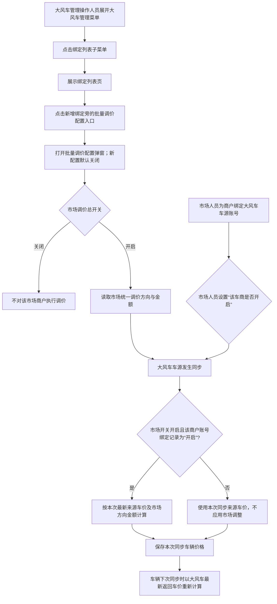

#AI:prd:file

# 信车 PC 多市场后台｜大风车同步车辆价格自动调整 PRD

> **文档类型**：单文件需求文档（PRD 已确认，Gate A 通过；按已确认方案进入原型设计，其他待确认项见 §8）
> **所属系统**：信车 PC 多市场管理后台
> **所属模块**：大风车管理 → 绑定列表（批量调价配置入口与弹窗）；市场人员为商户执行的大风车车源账号绑定
> **文档版本**：v1.11
> **更新说明**：v1.11（2026-10-15）：按 YAN 明确确认商户绑定交互：市场级“大风车车辆价格自动调整”开启时，绑定页显示“批量调整价格”模块，模块文案为“该车商是否开启”，选项“开启/关闭”；新绑定默认关闭，解绑后重绑按新绑定处理并默认关闭；已有绑定修改回显该绑定关系的已保存值。市场总开关关闭时不显示该模块；其他未确认事项保留。
> **最后更新**：2026-10-15

> **确认记录（2026-10-15）**：YAN 明确确认：市场总开关开启时绑定页面展示“批量调整价格”模块，模块文案为“该车商是否开启”，选项为“开启/关闭”，新绑定默认“关闭”；解绑后重绑视作新绑定、默认“关闭”；已有绑定修改回显该绑定关系已保存值。总开关关闭时不显示该模块。本版 v1.11 记录该规则，Gate A 依既有确认保持通过。


## 第一部分 · 概念对齐（已确认）

- **目标**：允许市场统一选择大风车同步车辆价格调整方向（增加或减少）并设置固定金额，由各商户决定“该车商是否开启”。
- **使用者**：市场人员维护市场级规则，并为商户绑定大风车车源账号；市场级开关开启时，在“批量调整价格”模块设置该车商是否开启市场调价。
- **核心规则**：市场统一选择增加或减少方向并设置调价金额，同市场参与商户使用相同方向和金额；方向与金额在“大风车管理 > 绑定列表”的配置弹窗中展示，且仅在“大风车车辆价格自动调整”开启时展示。调价金额为正整数元、不设最大值。只有市场总开关开启且商户绑定记录为“开启”时才调价；每次同步均以大风车本次返回的最新车价为基数。减少方向下若计算结果小于等于 0，车辆价格展示“面议”。不对未再同步的存量车辆追溯调整。
- **范围**：本期仅针对大风车同步车辆；按市场独立配置能力设计，不扩展为所有车源平台通用调价或批量改价。
- **已有依据**：YAN 已确认 PC 后台左侧“大风车管理”菜单位于客户管理下方，其下有“绑定列表”子菜单，点击后展示绑定列表页；本功能总开关承载于该页。市场配置页由超管配置，市场管理员无权控制该开关，因此不将总开关放在市场配置页。
- **待补充**：弹窗内方向控件形式及总开关、方向/金额的具体操作角色权限。金额仅允许正整数元、不设最大值、错误提示文案，以及减少后结果小于等于 0 时展示“面议”均已确认；其他弹窗交互亦按已确认口径收敛。

## §1 产品概述

在信车 PC 左侧“大风车管理”菜单下的“绑定列表”页，“新增绑定”旁提供“批量调价配置”入口。点击后打开同名弹窗，弹窗初始隐藏。弹窗包含“大风车车辆价格自动调整”控件，以“开启/关闭”两个按钮状态呈现；新配置默认关闭，已有配置再次打开时回显已保存值。开关下方提示文字“开启后，大风车同步的车辆自动调整车辆价格”保持原文并以蓝色显示。开启后展示统一调价方向和金额，方向默认“增加”；金额标签为“调价金额”，输入末尾显示“元”，只允许正整数且不设最大值。金额为空、为 0、为负数或格式不合法时不可保存，并在输入框下方以红字提示“输入金额不符合规范”。减少方向下若调价金额大于车辆原价、导致结果小于等于 0，则车辆价格展示为“面议”。关闭时方向金额控件隐藏。点击“确定”保存，点击“取消”关闭且不保存本次修改。弹窗初始隐藏与新配置开关默认关闭是两个不同状态。商户绑定操作角色已确认由市场人员执行；市场级规则的查看/编辑权限仍待确认。市场配置页由超管配置，市场管理员无权控制该入口。“批量调价配置”仅打开市场级规则弹窗，不代表对存量车辆批量改价；同步仍按本次最新来源价及当时有效方向、金额处理。

市场开关是全市场调价能力的总闸，商户选项是该商户的参与控制。两者同时生效才执行调价。规则不改变同步之外的存量车辆；重复同步不累加历史调整价。

## §2 目标用户与使用场景

| 用户 | 场景 | 目标 |
| --- | --- | --- |
| 大风车管理相关操作人员（市场级规则查看/编辑角色待确认） | 市场希望维护大风车同步车辆的统一调价规则 | 在“大风车管理 > 绑定列表”点击“新增绑定”旁的“批量调价配置”入口，打开同名弹窗；市场级规则查看/编辑权限待确认 |
| 市场人员 | 为商户绑定大风车车源账号 | 由市场人员在账号绑定操作中设置“该车商是否开启” |
| 市场及商户运营人员 | 车辆再次从大风车同步 | 确保本次价格基于最新来源车价计算，不因重复同步而重复累计历史调价 |

“批量调价配置”入口位于“大风车管理 > 绑定列表”页的“新增绑定”旁；点击后打开同名弹窗。页面初始不展示弹窗。新建配置时“大风车车辆价格自动调整”控件处于“关闭”按钮态，并可切换为“开启”；已有配置再次打开时回显已保存值。开关下方的既有提示文字保持原文并以蓝色显示。开启后展示统一调价方向和金额，方向默认“增加”，金额标签为“调价金额”，输入末尾显示“元”；关闭时隐藏方向和金额。点击“确定”保存；点击“取消”关闭且不保存本次修改。弹窗初始隐藏与新配置开关默认关闭分别指弹窗显隐和配置初值。“批量调价配置”仅打开规则配置，不对存量车辆执行批量改价。

## §3 核心用户动线



### 3.1 关键约束

- 市场统一配置增加或减少方向及固定金额；同一市场内的参与商户方向与金额一致，不允许商户覆盖。
- 市场人员在绑定记录中将“该车商是否开启”设为“关闭”时，该商户的大风车同步车辆不应用该市场调价规则。
- 市场总开关关闭时，即使绑定关系中的“该车商是否开启”为“开启”，也不执行调价。
- 只在大风车车辆同步时计算；不因市场金额或市场人员对商户“开启/关闭”选择的设置发生变化而批量改写既有车辆。
- 重复同步时，以本次大风车返回的最新车价为基数，按当前市场配置的方向和金额重新计算，不在上次已调整价格上再次叠加。

## §4 功能清单

```text
大风车同步车辆价格自动调整
├── 🔴 市场级调价总开关
│   ├── 位于“大风车管理”菜单下
│   ├── 已确认承载页：大风车管理 > 绑定列表
│   └── 开关开启后在配置弹窗中展示统一方向与固定金额
├── 🔴 市场人员配置商户参与方式
│   └── 市场人员为商户绑定大风车车源账号时设置“该车商是否开启”
└── 🔴 同步计价规则
    ├── 市场开关开启且该商户账号绑定记录为“开启”时按市场方向、金额调整
    ├── 以每次同步最新来源车价为基数
    └── 不追溯更改未再同步的存量车辆
```

## §4.1 关键页面位置线框

```text
左侧导航及绑定列表页（承载方式已确认）
┌─────────────────────────────────────────────────────────────┐
│ 客户管理                                                     │
│ 大风车管理                                                   │
│   绑定列表  ← 点击后打开绑定列表页                            │
│                                                             │
│ 大风车绑定列表（字段/列依据 YAN 新附截图；本文件未推断细节）   │
│ [新增绑定] [批量调价配置]                                     │
│                                                             │
│ 点击“批量调价配置”后打开同名弹窗                              │
│ 弹窗：“大风车车辆价格自动调整” [开启 | 关闭]（新配置默认关闭） │
│ 提示（蓝色）：开启后，大风车同步的车辆自动调整车辆价格        │
│ 开启时展示：调价方向 [增加]、调价金额 [      ] 元              │
│ [确定] [取消]；取消不保存本次修改                              │
└─────────────────────────────────────────────────────────────┘

市场人员为商户绑定大风车车源账号 · 页面和字段顺序待补充
┌──────────────────────────────────────────┐
│ 大风车车源账号绑定                         │
│ 账号信息 …                                │
│ 该车商是否开启 [开启 | 关闭]（新绑定默认关闭） │
└──────────────────────────────────────────┘
```

> YAN 已确认左侧“大风车管理”位于客户管理下方，展开后提供“绑定列表”子菜单，点击展示新附截图中的绑定列表页；配置入口与弹窗标题为“批量调价配置”。v1.9 确认“开启/关闭”按钮态、蓝色提示、方向默认“增加”、金额标签“调价金额”及单位“元”。v1.11 确认绑定页面市场总开关开启时显示“批量调整价格”模块、文案“该车商是否开启”、选项“开启/关闭”、新绑定与解绑后重绑默认“关闭”、既有绑定回显已保存值；市场总开关关闭时隐藏该模块。市场人员为商户绑定账号的操作角色已确认；绑定关系保存反馈仍待确认。

## §5 功能详细描述

### 5.1 市场级“大风车车辆价格自动调整”配置

**入口与位置**：信车 PC 左侧导航 →“大风车管理”（位于客户管理下方）→“绑定列表”。点击子菜单后展示绑定列表页，在“新增绑定”旁显示“批量调价配置”入口；点击后打开标题为“批量调价配置”的弹窗。开关开启后展示市场统一调价方向和金额。绑定列表其他字段、筛选项、列顺序和操作项按 YAN 已提供截图核对；未明确的字段规则不推断。市场配置页由超管配置，市场管理员无权控制此开关，因此不在市场配置页设置总开关。

**字段与业务规则**：

| 项目 | 规则 |
| --- | --- |
| 配置入口/弹窗标题 | 批量调价配置 |
| 按钮位置 | “大风车管理 > 绑定列表”页，位于“新增绑定”旁 |
| 点击行为 | 打开标题为“批量调价配置”的弹窗；页面默认不自动展示该弹窗 |
| 弹窗开关名称 | 大风车车辆价格自动调整 |
| 弹窗开关状态 | “开启/关闭”两个按钮状态；新配置默认“关闭”，已有配置再次打开时回显已保存值 |
| 弹窗提示语 | 开启后，大风车同步的车辆自动调整车辆价格；保持原文，以蓝色显示 |
| 配置范围 | 当前市场级；位于绑定列表页的配置弹窗；启用后由市场人员在为商户绑定账号时设置“该车商是否开启” |
| 调价方向 | 开关开启后展示市场统一方向，选项为增加或减少，默认“增加”；具体控件形式待补充 |
| 调价金额 | 开关开启后展示并设置市场统一金额；标签“调价金额”，输入末尾显示单位“元”；仅允许正整数且不设最大值。为空、为 0、为负数或格式不合法时禁止保存，并在输入框下方红字显示“输入金额不符合规范”；同一市场内各参与商户方向与金额一致 |
| 弹窗操作 | 确定保存本次配置；取消关闭弹窗且不保存本次修改 |
| 影响车源 | 仅大风车同步车辆 |
| 关闭效果 | 市场开关关闭时，不应用市场调价金额 |
| 配置变更影响 | 不追溯更改未再同步的存量车辆；后续同步按当时有效规则计算 |

**开关与金额依赖**：市场总开关和方向、金额配置位于“大风车管理 > 绑定列表”的“批量调价配置”弹窗；开关开启后展示统一方向与金额。方向默认“增加”；金额标签为“调价金额”，输入末尾为“元”，仅接收正整数且不设最大值。为空、为 0、为负数或格式不合法时禁止保存，输入框下方红字显示“输入金额不符合规范”。执行调价还须市场人员在该商户账号绑定记录中设置为“开启”。方向控件形式仍待补充。

**状态清单**：

| 状态 | 条件 | 业务效果 |
| --- | --- | --- |
| 市场规则关闭 | 市场调价开关关闭 | 该市场下商户均不执行市场调价 |
| 市场规则开启 | 市场调价开关开启且方向与金额已配置 | 市场人员可在为商户绑定账号时设置“开启/关闭”；金额须为正整数元，校验规则见字段表 |
| 弹窗新建配置 | 首次打开配置弹窗且尚无已保存配置 | “大风车车辆价格自动调整”默认关闭；方向和金额隐藏 |
| 弹窗编辑已有配置 | 打开已有配置 | 开关、方向和固定金额回显已保存值；开关关闭时方向和金额控件隐藏 |
| 弹窗取消 | 用户点击“取消” | 关闭弹窗且不保存本次修改 |
| 商户关闭 | 市场规则开启，但该商户账号绑定记录为“关闭” | 该商户同步车辆不应用市场调价 |
| 商户开启 | 市场规则开启且该商户绑定记录为“开启” | 该商户的大风车车辆同步时按市场方向和金额调整 |

**交互说明**：用户从左侧“大风车管理”展开并点击“绑定列表”后进入绑定列表页；页面初始不展示配置弹窗。点击“批量调价配置”入口后打开同标题弹窗。新建配置时“大风车车辆价格自动调整”默认处于“关闭”按钮态；已有配置再次打开时回显已保存值。开关开启后显示统一方向和金额，方向默认“增加”。金额标签为“调价金额”，输入末尾为“元”，只接受正整数且不设最大值；为空、为 0、为负数或格式不合法时不可保存，在输入框下方以红字提示“输入金额不符合规范”。开关下方既有提示文字保持原文并以蓝色显示。点击“确定”保存；点击“取消”关闭且不保存本次修改。入口与页面路径已确认：“大风车管理 > 绑定列表”；市场级规则查看/编辑权限仍待确认。保存只影响之后符合条件的大风车同步，不批量改历史车辆。

### 5.2 市场人员绑定商户账号时设置是否开启调价

市场级“大风车车辆价格自动调整”开关开启时，市场人员为商户绑定大风车车源账号的页面显示“批量调整价格”模块；市场级开关关闭时，该模块不显示。模块内文案为“该车商是否开启”，选项为“开启/关闭”。新绑定默认“关闭”。

该选择记录于对应商户账号绑定关系，只控制该车商同步车辆是否使用所属市场调价规则；不改变市场统一的调价方向和金额，也不影响同市场其他车商。选“关闭”时，该车商同步车辆不应用市场调价，且绑定记录上的设置不能绕过市场总开关。

修改已有绑定时，模块回显该绑定关系的已保存值。解绑后重新绑定按新绑定处理，默认“关闭”。市场人员在“大风车管理 > 绑定列表”进入账号绑定操作；绑定入口与导航路径已确认，绑定关系保存反馈仍待确认。商户不执行账号绑定或设置操作。

### 5.3 大风车同步计价与重复同步

对每次大风车同步记录，按以下顺序判断：

1. 识别同步来源为大风车；其他平台来源不在本期调价范围。
2. 读取当前所属市场的调价开关、统一调价方向与固定金额，以及市场人员在该商户账号绑定记录中设置的“开启/关闭”选择。
3. 若市场开关开启且该商户绑定记录为“开启”：以大风车本次返回的最新车价为基数，按市场统一设置的方向与金额计算车辆本次同步价格（增加时在来源价上增加该金额；减少时在来源价上减少该金额）。
4. 减少方向下，若调价金额大于车辆原价，导致计算结果小于等于 0，则该车辆本次同步价格展示为“面议”。
5. 若任一调价条件未满足：不应用市场调价，车辆价格按本次同步来源价格处理。
6. 保存本次同步结果，不以车辆上次已调整的展示价作为下次计算基数。

**重复同步示例**：市场方向为增加、调价金额为正整数 `A` 元时，某次大风车返回最新价格 `P1`，本次结果为 `P1 + A`；下次返回 `P2`，本次结果为 `P2 + A`。市场方向为减少时，正价结果为 `P1 - A`、`P2 - A`；若当次结果小于等于 0，则车辆价格展示“面议”。任何一次都不以此前已调整价格为基数，也不在上次结果上再次叠加。

**存量边界**：没有发生新一轮大风车同步的车辆不因市场开关、调价方向、金额或市场人员设置的商户“开启/关闭”选择变化而被追溯改价。后续正常同步时才按当次最新来源价格与当时生效配置的方向、金额重新计算。

## §6 文案规范

| 场景 | 文案/字段名 | 状态 |
| --- | --- | --- |
| 配置入口/弹窗标题 | 批量调价配置 | 入口位于“大风车管理 > 绑定列表”页“新增绑定”旁；点击打开同名配置弹窗 |
| 弹窗开关 | 大风车车辆价格自动调整 | “开启/关闭”两个按钮状态；新配置默认关闭；已有配置回显已保存值 |
| 弹窗提示语 | 开启后，大风车同步的车辆自动调整车辆价格 | 开关下方以蓝色显示；文字保持不变 |
| 调价方向 | 增加 / 减少 | 开关开启后展示市场统一方向，默认“增加”；控件形式待补充 |
| 金额字段 | 调价金额 | 输入末尾显示单位“元”；仅允许正整数、不设最大值；空值、0、负数或格式不合法时禁止保存，并显示红字“输入金额不符合规范” |
| 弹窗操作 | 确定 / 取消 | 确定保存；取消关闭弹窗且不保存本次修改 |
| 商户绑定时调价模块 | 批量调整价格 | 市场人员在“大风车管理 > 绑定列表”入口进入账号绑定操作；市场总开关开启时显示、关闭时隐藏；模块文案“该车商是否开启”，选项“开启/关闭”；新绑定和解绑后重绑默认关闭；修改既有绑定回显该绑定关系已保存值 |
| 保存成功/失败 | “待补充：沿用绑定列表页现有反馈” | 具体反馈待核实 |

## §7 非功能性需求与约束

- **权限**：总开关归属“大风车管理”，由具备相应操作权限的角色维护；具体操作角色及其与市场管理员/超管的权限边界待 YAN 确认。市场配置页由超管配置，市场管理员无权控制此开关。商户绑定账号及该商户“开启/关闭”设置由市场人员操作已确认；不新增权限角色。
- **数据范围**：调价开关、方向和金额按市场隔离；不得把市场 A 的配置应用于市场 B。
- **同步适用范围**：本期识别大风车同步车源；不得推广为所有平台通用调价。
- **幂等/重复处理**：重复同步均以本次大风车最新车价，按当前市场方向和金额重新计算，避免重复叠加市场金额。
- **历史数据**：未再同步的现有车辆不追溯调整。
- **审计**：是否记录市场开关、调价方向/金额、商户“开启/关闭”选择的操作人和变更时间，沿用系统现有设置审计能力；若系统无该能力，具体审计要求待补充。
- **性能与失败处理**：同步任务性能目标、来源价格缺失/格式异常时的失败处理、重试策略待补充；不得猜测来源异常时的回退价格。

## §8 待确认问题

- [ ] **弹窗其他关闭行为及保存反馈**：确认点击遮罩、右上角关闭按钮等行为，以及保存成功/失败反馈。确定保存、取消关闭且不保存本次修改已确认；其余关闭方式与反馈待确认。
- [ ] **关闭已有配置后的方向/金额保留**：确认关闭已有配置并保存后是否保留方向/金额。重新打开时已有配置按保存值回显；该问题仅涉及关闭后配置保留规则。
- [ ] **是否立即生效**：保存市场级开关及方向/金额后何时对后续同步生效（立即或其他生效时点）待确认；不得把按钮名称解释为对存量车源批量执行改价。
- **历史核对说明**：此前曾将绑定列表字段、筛选项、列顺序和操作项列为待截图核对，并要求截图未随附件时暂缓原型；YAN 已提供截图并确认 PRD 与原型，闸门 A 已通过。该待办已关闭，不再作为当前原型阻塞项；仅记录历史状态，不据此扩展字段或规则。
- [ ] **操作角色与权限边界**：确认“大风车管理 > 绑定列表”及市场总开关由哪些角色查看/编辑，尤其市场管理员与超管的职责边界。商户大风车账号绑定及“该车商是否开启”设置由市场人员操作已确认；不新增权限角色。影响 §5.1、§5.2、§7。
- [ ] **同步 API、异常与审计**：大风车同步 API/接口约定、车价缺失或无效时的处理、重试与告警，以及是否要求记录规则命中详情/变更审计。影响 §5.3、§7。

## §9 验收标准

1. PC 后台左侧“大风车管理”位于客户管理下方；展开后显示“绑定列表”子菜单，点击后进入绑定列表页。列表页“新增绑定”旁显示“批量调价配置”入口；页面初始不自动展示配置弹窗，点击入口后才打开同名弹窗。
2. 新建配置时，“大风车车辆价格自动调整”控件以“开启/关闭”两个按钮状态呈现，默认处于“关闭”；页面初始弹窗隐藏。两者分别核验为弹窗显隐状态与新配置开关初始值。已有配置再次打开时，开关及已配置方向、金额回显已保存值。
3. 开关下方提示文字保持“开启后，大风车同步的车辆自动调整车辆价格”，并以蓝色显示。开关开启时，弹窗展示市场统一调价方向和金额，方向默认“增加”；金额标签为“调价金额”，输入末尾显示“元”。开关关闭时方向金额控件隐藏。
4. 点击“确定”保存本次配置；点击“取消”关闭弹窗且不保存本次修改。按钮和弹窗仅用于配置市场级规则，不触发已存量车辆批量改价；不得将总开关放在由超管配置、市场管理员无权控制的市场配置页。
5. 市场级“大风车车辆价格自动调整”开关开启时，绑定页面显示“批量调整价格”模块；关闭时不显示该模块，商户绑定设置不能绕过市场总开关。
6. 市场调价开关开启后，市场内统一调价方向与固定金额一致；市场人员不得为单个商户覆盖方向或金额。
7. 市场调价开关开启、商户绑定记录为“开启”且金额合法时，大风车每次同步均以本次最新返回车价为基数，按市场统一方向与金额计算；金额必须是正整数元，不设最大值。金额为空、为 0、为负数或格式不合法时不可保存，并在输入框下方红字显示“输入金额不符合规范”。
8. “批量调整价格”模块文案为“该车商是否开启”，选项为“开启/关闭”；新绑定默认关闭，解绑后重绑按新绑定处理且默认关闭；修改既有绑定时回显该绑定关系已保存值。
9. 市场开关开启但该商户账号绑定记录为“关闭”时，该车商大风车同步车辆不应用市场金额。
10. 其他来源平台车辆不套用本期大风车调价规则。
11. 未再同步的存量车辆不会因市场配置或市场人员对商户“开启/关闭”选择的变更而被追溯调整；“批量调价配置”入口不得对其执行批量改价。
12. 同一车辆重复同步时，按本次最新大风车车价和当前市场方向、金额重新计算，不在上次已调价结果上重复累加或扣减。
13. 减少方向下，调价金额大于车辆原价且计算结果小于等于 0 时，车辆价格展示“面议”。
14. 市场之间配置互相隔离；一个市场的开关、方向或金额变更不影响其他市场。
15. 方向控件细节、弹窗其他关闭方式、保存反馈、生效时点、市场级规则操作权限、同步 API/接口和异常处理按 §8 确认后补充对应验收项；确认前不以假定值作为验收标准，不因此扩展新页面。

---

## 方向校验（待确认）

| 核对项 | 当前定义 |
| --- | --- |
| 用户问题 | 市场需要对大风车同步车辆统一选择增加或减少价格并设置固定金额，同时允许市场人员在为商户绑定账号时设置该商户是否参与；市场调价总开关由“大风车管理”菜单控制，避免放在市场管理员无权控制的市场配置页 |
| 业务价值 | 统一市场层面的调价方向和金额口径，减少市场人员与商户运营者各自重复调整；价值描述不扩展至收益保证 |
| 技术边界 | 价格处理位于大风车同步流程；每次用最新来源价格重新计算；接口、任务与存储实现不在本 PRD 展开 |
| 非目标 | 不调所有平台车辆、不批量改历史存量、不对历史调整结果重复增加或减少、不允许商户自定方向或金额 |
| 确认门禁 | YAN 已确认“大风车管理 > 绑定列表”配置入口和弹窗规则；PRD v1.7 通过 Gate A，v1.8 收敛方向金额配置位置，v1.9 纳入弹窗交互，v1.10 确认金额校验与“面议”边界，v1.11 确认商户绑定模块显隐、文案、选项、默认态、重绑和既有绑定回显。Gate A 保持通过；市场级规则查看/编辑权限等待确认事项仍按 §8 保留 |

<!-- #AI:prd:start -->
<!-- #AI:prd:end -->
