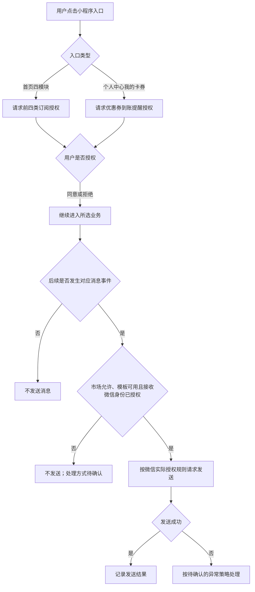

<!-- #AI:prd:file -->
# 信车小程序订阅消息通用配置 PRD

| 项目 | 内容 |
| --- | --- |
| 文档版本 | v1.0 |
| 日期 | 2026-11-04 |
| 状态 | YAN 已确认本次编辑态市场关闭限制，本次增量闸门 A 通过；其他待确认项见第 9 节。 |
| 适用产品 | 信车微信小程序及其市场配置能力 |
| 首期范围 | 海西市场 |

## 1. 项目背景与目标

订阅消息能力需要在信车小程序中复用，并允许各市场管理本市场消息发送许可。首期在海西市场落地，覆盖优惠券、团购商品和活动相关的五类消息。

本文档是独立需求，不并入或修改《海西团购迭代升级 PRD V3.0》。两份 PRD 各自维护；本文只引用海西现有小程序入口名称和业务对象作为本期触发场景。

## 2. 目标与范围

### 2.1 本期目标

- 建立信车小程序可复用的五类订阅消息能力，海西为首期市场。
- 按市场控制本市场五类消息是否允许发送。
- 在已确认的小程序入口请求用户订阅授权；用户拒绝时仍可继续进入所选业务。
- 新活动通知与 Banner 发布动作关联，并由市场级允许状态和 Banner 单次选择共同控制。

### 2.2 本期范围

| 范围 | 内容 |
| --- | --- |
| 市场配置 | PC「微店管理」下新增「订阅消息管理」模块；五类消息分别设置开关，优惠券和团购商品临期提前天数可自定义。未保存过开关配置的市场五类默认关闭；已配置市场按已保存值回显、不重置。界面布局和角色权限留待原型阶段确认。 |
| 消息类型 | 新优惠券通知、优惠券到期提醒、团购商品到期提醒、新活动通知、优惠券到账提醒。团购商品上新通知已于 2026-11-09 按 YAN 要求取消，不在本期范围。 |
| 小程序授权入口 | 首页「会员福利」「停车缴费」「超值团购」「车况查询」四个模块，以及个人中心「我的卡券」。 |
| 活动触发 | 市场级允许后，Banner 发布时可单次开启新活动通知，并填写活动主题、说明和时间。 |

### 2.3 不纳入本次五类消息

海西现有认证流程中的认证审核通知与本文五类通用消息相互独立，不在本文范围内。

## 3. 消息类型与接收范围

| 消息类型 | 业务触发方向 | 接收范围 |
| --- | --- | --- |
| 新优惠券通知 | 市场内新优惠券可通知时 | 符合该市场现有业务关联并已授权该类消息的微信身份 |
| 优惠券到期提醒 | 相关优惠券临期时 | 相关优惠券持有人中已授权该类消息的微信身份 |
| 团购商品到期提醒 | 相关团购商品临期时 | 相关团购商品持有人中已授权该类消息的微信身份 |
| 新活动通知 | 市场级允许，且 Banner 发布时开启本次通知 | 符合该市场现有业务关联并已授权该类消息的微信身份 |
| 优惠券到账提醒 | 市场在后台配置的自动发放卡券到账时 | 获得该卡券并已授权该类消息的微信身份 |

按业务事件与完成相应消息授权的微信身份匹配接收人；哪个微信身份完成该类授权，就向哪个微信身份发送。市场注册关系及用户归属沿用现状，不把“已注册用户”单独作为所有消息的唯一筛选条件。具体身份关联方式按现有数据/接口对接。

当前模板申请状态：五类模板（新优惠券通知、优惠券到期提醒、团购商品到期提醒、新活动通知、优惠券到账提醒）均已在微信公众平台申请完毕（2026-11-09 YAN 确认）。“已申请完毕”代表模板申请动作完成，不代表已核验可发送；实际发送仍须符合微信平台审核与授权规则。团购商品上新通知模板虽已申请，但按 2026-11-09 YAN 要求取消该通知类型，不再配置开关、不请求授权、不发送。

## 4. 市场配置规则

### 4.1 五类消息的市场开关与临期配置

- PC 后台在「微店管理」下新增「订阅消息管理」模块，按市场分别管理本市场五类消息；页面不再展示「团购商品上新通知」配置项。
- 五类消息各自设置开/关；某类关闭时不发送该类消息，其他类型按各自开关判断。
<!-- #AI:prd:start -->
- 优惠券到期提醒、团购商品到期提醒均配置临期提前天数，天数可自定义。是否有默认值不在本 PRD 预设。
- 市场此前未配置/保存过订阅通知开关时，五类消息开关默认全部关闭；已配置市场切回时按该市场已保存配置回显，不重置。已保存过「团购商品上新通知」开关的历史数据不再展示、不再生效。
- 后台页面布局、角色权限及具体字段呈现留待原型阶段确认，不阻塞本版已确认业务规则。
<!-- #AI:prd:end -->

### 4.2 新活动通知

- 新活动通知采用两层控制：PC「订阅消息管理」中的新活动通知开关，以及 Banner 配置/发布时本次活动通知开关；两者均开启才发送。
- Banner 发布人开启本次通知时，填写活动主题、说明和时间；新活动通知随该 Banner 发布发送。
<!-- #AI:prd:start -->
- Banner 本次开启新活动通知时，活动主题最多 20 字，活动说明最多 20 字；活动时间使用 Element 日期选择组件选择日期，仅选择日期，不增加时间选择。
- 原型说明：轮播图弹窗图片上传区旁的格式/尺寸说明文案保留；移除活动字段下方的“市场开关待配置，当前不能判断是否满足通知条件。”提示。
<!-- #AI:prd:end -->
<!-- #AI:prd:start -->
- 新增轮播图时，若市场「订阅消息管理」中的「新活动通知」开关关闭，则新增弹窗内本次「新活动通知」无法开启。用户点击尝试开启时，仅显示已有 Toast：「请先去订阅消息管理中开启新活动通知功能」，本次开关保持关闭；活动主题、活动说明、活动日期三个字段继续隐藏，不显示空态或必填提示。新增态既有规则不变。
- 编辑已保存 Banner 时，若市场「新活动通知」开关关闭，本次通知开关也无法开启。用户点击尝试开启时显示 Toast：「请先去订阅消息管理中开启新活动通知功能」，本次开关保持关闭；活动主题、活动说明、活动日期字段保持隐藏，不显示编辑态红色小字提示或弹窗底部市场关闭提示。
<!-- #AI:prd:end -->
- 未开启本次通知时，Banner 仍按既有流程发布，不发送新活动通知。
<!-- #AI:prd:start -->
- 已保存 Banner 再次进入编辑时，本次新活动通知开关默认关闭。市场开关开启时，编辑态用户可主动开启本次通知，活动主题、活动说明、活动日期字段显示，开关下方显示红色小字提示「开启后会再次发送微信订阅通知」，表示本次编辑保存/发布会再次触发订阅通知。
- Banner 编辑或重复发布时仍须同时满足市场级新活动通知开关和本次通知开关开启，才发送新活动通知；编辑态本次开关默认关闭，需由用户主动开启。
<!-- #AI:prd:end -->

## 5. 小程序授权入口与交互

### 5.1 首页四个入口

用户点击首页「会员福利」「停车缴费」「超值团购」「车况查询」任一模块时，先展示订阅消息授权弹窗，再进入用户选择的业务模块。授权拒绝、关闭或未完成时，不阻断业务进入。

弹窗的设计目标是在同一授权面板展示以下四类消息：

1. 新优惠券通知
2. 优惠券到期提醒
3. 团购商品到期提醒
4. 新活动通知

YAN 已确认同一订阅授权面板可展示四个推送项（原五项中的「团购商品上新通知」已于 2026-11-09 取消）；该项作为本产品需求记录。授权请求、模板配置及消息发送仍遵循微信实际规则；具体模板须完成申请并处于平台允许使用状态后，才具备相应发送条件。

### 5.2 个人中心「我的卡券」入口

点击个人中心「我的卡券」入口时，触发第五类「优惠券到账提醒」的订阅授权请求。用户拒绝、关闭或未完成授权时仍进入「我的卡券」。该类消息只覆盖市场在后台配置的自动发放卡券；业务事件关联到实际获得卡券的用户，再向完成该类型订阅授权的微信身份发送。不包括用户主动领取或人工补发。

### 5.3 授权状态

- 授权与发送遵循微信实际规则，包括用户授权状态及平台允许的请求和发送条件；本 PRD 不另行定义授权持久状态、授权有效期或重请求时机。
- 用户拒绝或未授权时，只影响相应消息是否具备发送授权，不影响进入其选择的业务模块。

### 5.4 临期提醒日期与发送时段

- 优惠券和团购商品的临期提前天数可配置。
- 优惠券有效期按自然日的开始/结束日期判断；团购商品临期提醒同样按有效期日期判断。提醒不得在凌晨发送。
- 上午/下午或具体发送时刻的配置方式留待界面阶段按本 PRD 进一步确认。
- 建议上午 10:00 作为默认时刻；该时刻及默认值尚未确认，不得当作定案。
- 临期状态筛选条件待确认。

## 6. 发送前置条件

单条消息发送前应满足对应消息的市场开关开启、业务事件已触发、接收人符合本 PRD 范围，并具备对应模板及该微信身份的授权。授权请求、模板配置和发送遵循微信实际规则；上述条件缺一时，不得将消息记为已送达。五类模板均已在微信公众平台申请完毕（2026-11-09 YAN 确认）；模板未核验可用前，仍不得视为具备对应发送条件。团购商品上新通知已取消，不参与发送。

### 6.1 异常与发送建议（待 YAN 确认）

以下是产品建议，不是已确认规则：

- 同一业务事件对同一接收微信身份、同一消息类型最多发送一次，避免重复推送。
- 发送失败不向用户重复骚扰；仅对平台暂时性失败做有限次数自动重试。拒绝授权、没有可用授权、模板不可用或业务数据校验失败时不重试。
- 记录发送成功、失败原因和重试状态；具体可重试次数及记录查看入口待确认。
- 对应消息开关关闭期间产生的事件不补发，开关重新开启后也不追溯发送。

## 7. 核心流程

## 8. 验收标准

- PC「微店管理」下提供「订阅消息管理」；五类消息均有各自的市场开关，关闭某类不影响其他类别的开关与发送；页面不展示「团购商品上新通知」。
<!-- #AI:prd:start -->
- 选择市场后，若该市场此前未配置/保存订阅通知开关，五类开关默认全部关闭；已配置市场切回时按该市场已保存配置回显，不重置。
<!-- #AI:prd:end -->
- 优惠券到期提醒和团购商品到期提醒分别提供可自定义的提前天数配置。
- 五类消息按第 3 节的业务事件和接收范围匹配；实际接收微信身份须是完成该消息类型授权的微信身份，市场注册关系沿现状匹配。
- 五类模板申请状态符合当前记录：五类均已在微信公众平台申请完毕；团购商品上新通知已取消且不再申请或配置。不得把“已申请完毕”表述为审核通过或已验证可发送。
<!-- #AI:prd:start -->
- 新活动通知须同时满足「订阅消息管理」中的新活动开关和 Banner 本次通知开关；填写活动主题（最多 20 字）、活动说明（最多 20 字）及活动日期后随 Banner 发布发送。活动日期通过 Element 日期选择组件选择，不添加时间选择。两项开关保持开启时，Banner 编辑或重复发布也发送。
<!-- #AI:prd:end -->
<!-- #AI:prd:start -->
- 新增轮播图时，若市场「新活动通知」开关关闭，点击开启本次通知仅显示 Toast「请先去订阅消息管理中开启新活动通知功能」，且本次通知开关保持关闭；活动主题、活动说明、活动日期三个字段保持隐藏，不显示空态或必填提示。
<!-- #AI:prd:end -->
<!-- #AI:prd:start -->
- 已保存 Banner 再次进入编辑时，本次新活动通知开关默认关闭；市场开关开启时，用户可在编辑态主动开启，活动主题、活动说明、活动日期字段显示，开关下方显示红色小字提示「开启后会再次发送微信订阅通知」。
- 编辑保存/发布仍以市场级新活动通知开关和本次通知开关均开启作为发送条件；再次编辑时需用户主动开启本次通知开关。
<!-- #AI:prd:end -->
<!-- #AI:prd:start -->
- 编辑已保存 Banner 时，若市场「新活动通知」开关关闭，点击尝试开启本次通知仅显示指定 Toast、开关保持关闭，三个活动字段保持隐藏；不显示编辑态红色小字或弹窗底部市场关闭提示。该规则不改变新增态既有规则。
<!-- #AI:prd:end -->
- 首页四个指定模块点击后展示订阅授权流程，用户拒绝或关闭后仍进入对应模块。
- 首页订阅授权面板同屏展示前四类推送项，是 YAN 已确认的需求；具体消息的模板仍须符合微信平台实际可用条件。
- 点击个人中心「我的卡券」时请求第五类优惠券到账提醒授权；拒绝或关闭后仍进入「我的卡券」。
- 用户授权状态与发送请求遵循微信实际规则，不由本 PRD 定义授权持久态。
- 临期天数可配置；日期按自然日判断，提醒不得在凌晨发送。同一人多条符合条件的消息逐条发送，不合并。
- 优惠券到账提醒只覆盖市场在后台配置的自动发放卡券，不包括用户主动领取或人工补发。
- 授权请求和五类模板的配置及发送遵循微信实际规则；模板未获准使用时不发送。
- 发送异常策略在 §6.1 中为建议，需确认后再作为验收标准。

## 9. 待确认事项

| 序号 | 事项 | 需确认内容 |
| --- | --- | --- |
| 1 | 模板 ID 与平台可用性 | 五类模板均已在微信公众平台申请完毕（2026-11-09）；各模板最终 ID、审核结果及可发送状态待落实。团购商品上新通知已取消，对应模板不再使用。未获批或不可用的模板不视为具备发送能力。 |
| 2 | 接收身份映射 | 按业务事件及对应消息授权微信身份匹配是已确认规则；具体现有数据/接口如何提供该映射，按实施输入核实。 |
| 3 | 临期提醒配置界面细节 | 提前天数可自定义已确认；上午/下午或具体时刻的配置方式、具体默认时刻及临期商品/券状态筛选待界面阶段确认。上午 10:00 仅为建议默认提案。 |
| 4 | 市场配置原型细节 | PC「微店管理」下的「订阅消息管理」入口及五类独立开关已确认；未配置/保存开关的市场五类默认关闭，已配置市场回显保存值且不重置；页面布局、角色权限、保存反馈和操作记录留待原型阶段确认，不阻塞本版业务规则。 |
| 5 | 发送幂等与失败策略 | §6.1 建议是否采纳待 YAN 确认；具体自动重试次数、失败记录查看入口以及关闭期间不补发建议待确认。 |

已按 YAN 本轮答复确认并移出待确认：四项推送项在同一授权面板展示（原五项，团购商品上新通知已取消）；PC「微店管理」下新增「订阅消息管理」并提供五类独立开关；临期提前天数可自定义；按完成该类型授权的微信身份推送；遵循微信授权持久状态规则、不另行定义；同一用户多条消息逐条发送；Banner 在市场级新活动开关和 Banner 本次通知开关均开启时，编辑或重复发布也推送；优惠券到账提醒仅包含市场配置的自动发放卡券。认证审核通知与本文五类范围隔离，不列入本待确认清单。

YAN 已确认本次编辑态市场关闭限制，闸门 A 通过。市场配置界面细节、模板审核/可用状态及发送异常策略仍按第 9 节跟进。
